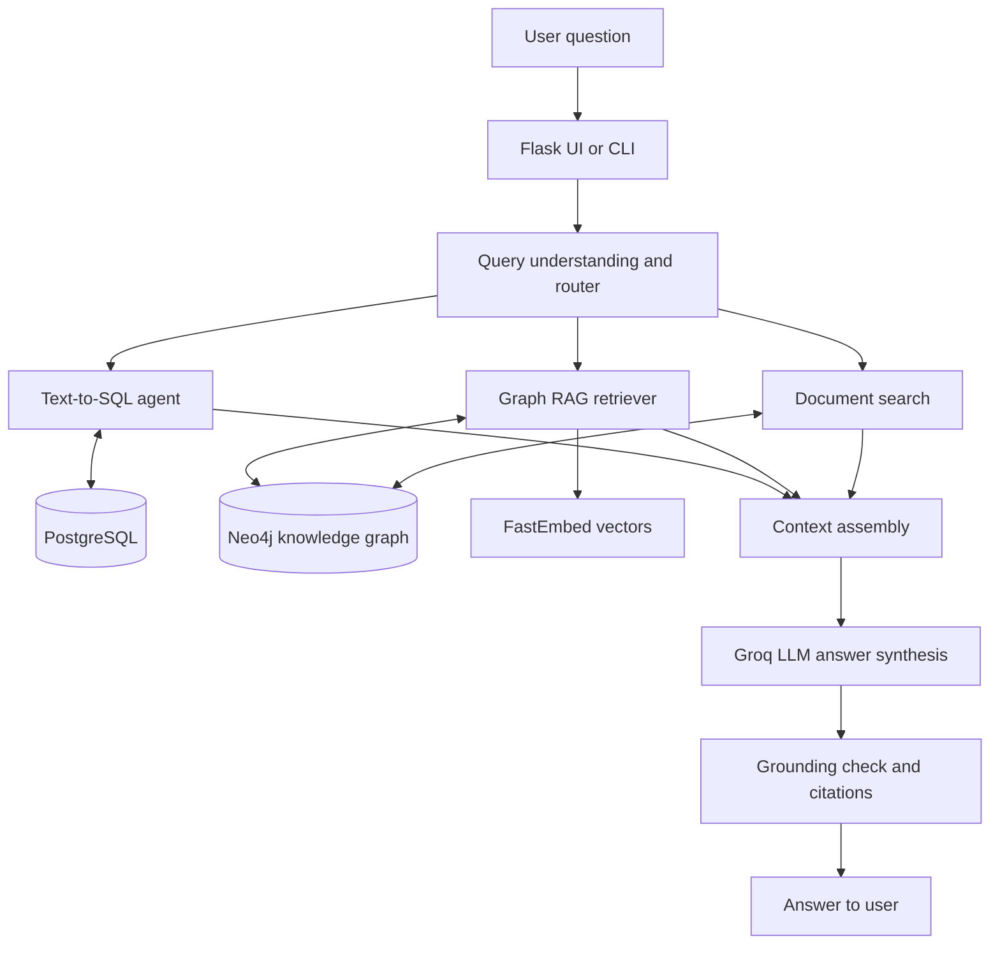

# Graph RAG-Based Intelligent HR Assistant

A small HR knowledge assistant that takes questions in plain English and decides which information source is best suited to answer them. It combines relational data, a knowledge graph and semantic document retrieval, then asks an LLM to produce a grounded answer with source references.

This is an academic/demo project. The included employee, candidate, review and project records are synthetic sample data generated with Faker; they are not real HR records.

## What it can do

- Answer structured questions about departments, employees, payroll, attendance, skills and project assignments using PostgreSQL and Text-to-SQL.
- Follow relationships such as employees, mentors, reviewers, projects, risks and recommendations through Neo4j.
- Retrieve relevant passages from policies, resumes, performance reviews and project reports using vector search.
- Route a question to SQL, Graph RAG, document search or a combination of them.
- Return an answer with `[SQL]`, `[Graph]` and `[Doc: ...]` citations, plus a basic grounding check.
- Provide a Flask web interface as well as a command-line interface.

## Architecture



### How a question moves through the system

1. **Understand and route:** the query-understanding agent identifies intent, entities and which sources are needed.
2. **SQL path:** when exact structured values are needed, the SQL agent generates and validates a read-only query against PostgreSQL.
3. **Graph path:** the Graph RAG retriever resolves entity anchors, searches related concepts, runs a constrained Cypher query and gathers nearby facts/documents from Neo4j.
4. **Document path:** FastEmbed creates local embeddings using `BAAI/bge-small-en-v1.5`; the vectors are stored and searched through Neo4j vector indexes.
5. **Synthesis:** the retrieved information is assembled into one context and sent to Groq for a structured answer.
6. **Grounding:** a final lightweight check looks for names and numbers in the answer that do not appear in the retrieved context.

## Tech stack

| Part | Technology |
|---|---|
| Language | Python |
| Relational data | PostgreSQL (works with local PostgreSQL or a hosted service such as Neon) |
| Knowledge graph and vector indexes | Neo4j |
| Embeddings | FastEmbed — `BAAI/bge-small-en-v1.5` (runs locally) |
| LLM | Groq API (model IDs are configurable) |
| Web interface | Flask, HTML, CSS and JavaScript |

## Repository layout

```text
.
├── data/
│   ├── raw/             # synthetic CSVs for PostgreSQL
│   ├── docs/            # synthetic HR policies, resumes, reviews and projects
│   ├── extracted/       # structured extraction examples/cache
│   └── ground_truth/    # evaluation facts
├── src/
│   ├── agents/          # query understanding, SQL and Cypher agents
│   ├── api/             # Flask server and static frontend
│   ├── data_gen/        # synthetic dataset generator
│   ├── db/              # PostgreSQL schema and setup/check scripts
│   ├── graph/           # Neo4j graph construction and indexes
│   ├── retrieval/       # document and graph retrieval
│   ├── config.py        # environment-based settings
│   ├── embeddings.py    # FastEmbed model wrapper
│   ├── llm.py           # Groq client and structured-output helper
│   └── pipeline.py      # end-to-end answer pipeline
├── .env.example
├── requirements.txt
└── README.md
```

## Getting started

### 1. Set up Python

Python 3.10 or newer is recommended. From the repository root:

```bash
python -m venv .venv
# Windows PowerShell
.venv\Scripts\Activate.ps1
# macOS/Linux (use this instead of the Windows command)
source .venv/bin/activate
pip install -r requirements.txt
```

### 2. Configure your own services

```bash
# Windows PowerShell
copy .env.example .env
# macOS/Linux
cp .env.example .env
```

Edit `.env` and fill in your own PostgreSQL, Neo4j and Groq credentials. Do not commit `.env`. For a hosted PostgreSQL instance such as Neon, set `PG_SSLMODE=require` if your provider requires TLS. Use a dedicated project database, not a database containing unrelated or production data.

The `.env.example` includes the supported Groq model defaults used by the project. You can change `GROQ_MODEL` and `GROQ_FALLBACK_MODEL` to model IDs available in your Groq account. See the [Groq model catalogue](https://console.groq.com/docs/models) for current availability.

### 3. Try the web interface without cloud services

For a quick UI preview, set this in `.env`:

```env
HR_MOCK=1
```

Then run:

```bash
python -m src.api.server
```

Open <http://127.0.0.1:5000>. Mock mode uses saved example responses and does not need PostgreSQL, Neo4j or a Groq key. It is intended to preview the interface, not to demonstrate live retrieval.

### 4. Build the live data stores

The repository already includes synthetic CSV data, sample documents and example extractions. If you want to regenerate the source dataset, run:

```bash
python -m src.data_gen.generate_data
```

Configure PostgreSQL and Neo4j first. **Important:** `src/db/schema.sql` drops and recreates the project's HR tables. The database setup command now requires an explicit opt-in so it cannot be run accidentally. Only run it against a dedicated database that you are happy to reset.

```bash
# Windows PowerShell
$env:ALLOW_DB_RESET = "1"
python -m src.db.setup_db
Remove-Item Env:ALLOW_DB_RESET

# macOS/Linux
ALLOW_DB_RESET=1 python -m src.db.setup_db
```

The setup script also creates a PostgreSQL read-only role for LLM-generated SQL. Set a strong `PG_READONLY_PASSWORD` in `.env` before running it.

Then build the graph and vector indexes:

```bash
python -m src.graph.build_from_sql
python -m src.graph.load_extractions
python -m src.graph.build_vectors
python -m src.graph.build_concept_index
```

The included `data/extracted/` files are sample extraction outputs. To re-run document extraction with the configured Groq model (this makes API calls), use:

```bash
python -m src.graph.extract_from_docs
python -m src.graph.load_extractions
```

The first embedding run downloads the FastEmbed model (roughly 70 MB) into `.cache/fastembed/`. That cache is local and intentionally excluded from Git.

### 5. Run the live assistant

Check service connectivity:

```bash
python -m src.check_connections
```

Run the sample question set:

```bash
python -m src.pipeline --demo
```

Or start an interactive terminal session:

```bash
python -m src.pipeline
```

Start the web UI in live mode (set `HR_MOCK=0` in `.env`):

```bash
python -m src.api.server
```

## Evaluation and diagnostics

```bash
python -m src.db.check_db
python -m src.graph.check_graph
python -m src.agents.eval_router
python -m src.agents.eval_sql
python -m src.retrieval.eval_graph
```

These scripts use the configured external services and may make database or Groq calls.

## Configuration reference

| Variable | Description |
|---|---|
| `PG_HOST`, `PG_PORT`, `PG_DB` | PostgreSQL host, port and database. |
| `PG_SSLMODE` | PostgreSQL SSL mode (`require` is commonly needed by hosted services). |
| `PG_ADMIN_USER`, `PG_ADMIN_PASSWORD` | Database owner credentials used for setup and graph construction. |
| `PG_READONLY_USER`, `PG_READONLY_PASSWORD` | Read-only account used for generated SQL and web data views. |
| `NEO4J_URI`, `NEO4J_USERNAME`, `NEO4J_PASSWORD`, `NEO4J_DATABASE` | Neo4j connection settings. |
| `GROQ_API_KEY` | API key for answer synthesis and extraction. |
| `GROQ_MODEL`, `GROQ_FALLBACK_MODEL` | Primary and fallback Groq model IDs. |
| `HR_MOCK` | Set to `1` for the UI preview using sample responses. |
| `APP_PASSWORD`, `SECRET_KEY` | Optional basic web sign-in and Flask session key. |
| `ALLOW_DB_RESET` | Must be `1` to permit the destructive PostgreSQL schema setup. |

## A few notes before using it with real data

- The included dataset is synthetic. Do not assume the demo policies or HR decisions are legally valid or suitable for an actual organisation.
- The SQL and Cypher agents include validation/read-only controls, but this is still a student project. Review the generated queries and security boundaries before connecting it to sensitive systems.
- The Flask app binds to `127.0.0.1` by default. The optional shared-password login is only a basic demo safeguard. Do not expose the interface to the public internet or use real employee data without proper authentication, authorization, auditing, and security review.
- Never commit `.env`, database dumps, local SQLite snapshots or downloaded model caches. If a credential has already been committed or shared, rotate it; deleting it from a later commit does not invalidate it.

## Project attribution

CSD 415 Project — Team 11, Department of CSE, Muthoot Institute of Technology and Science (MITS), Kochi (2023–2027 batch).

Joanne Alice Thomas, John Issac Meleth and Navneeth Byju. Guide: Neethu A. S.
